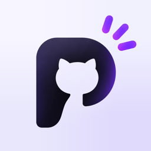
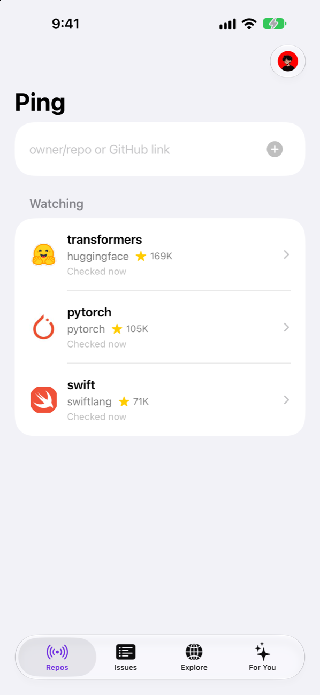
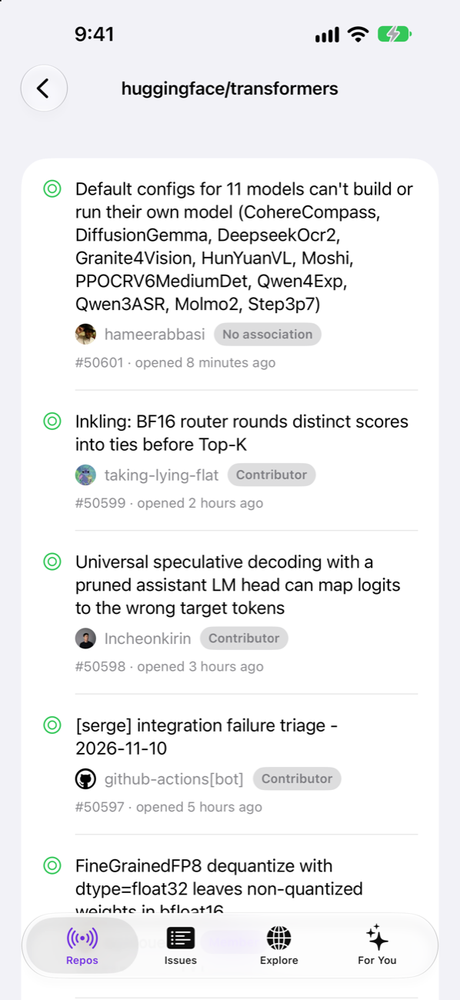
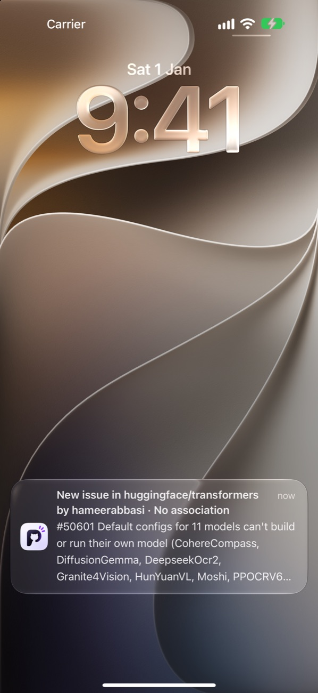
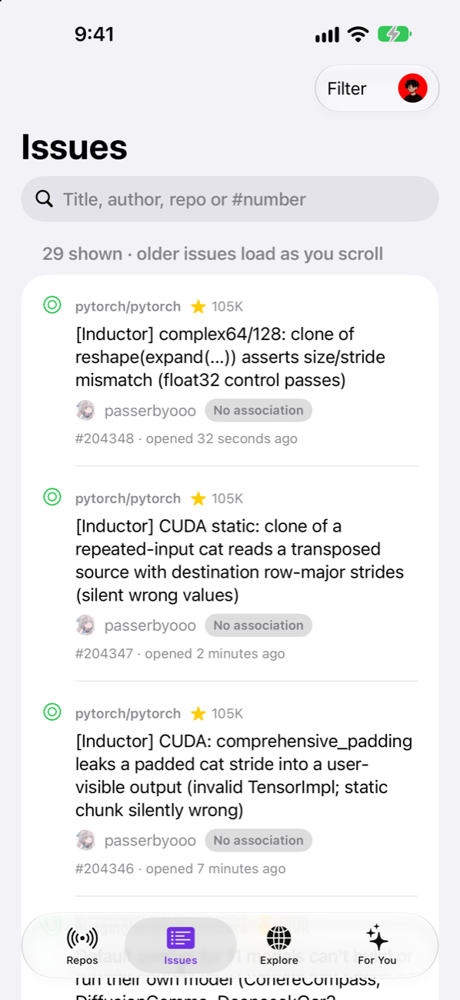
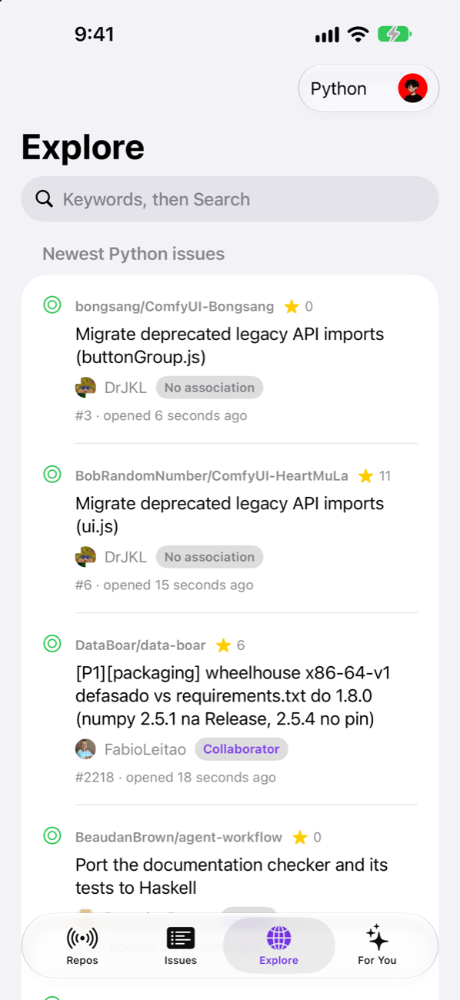
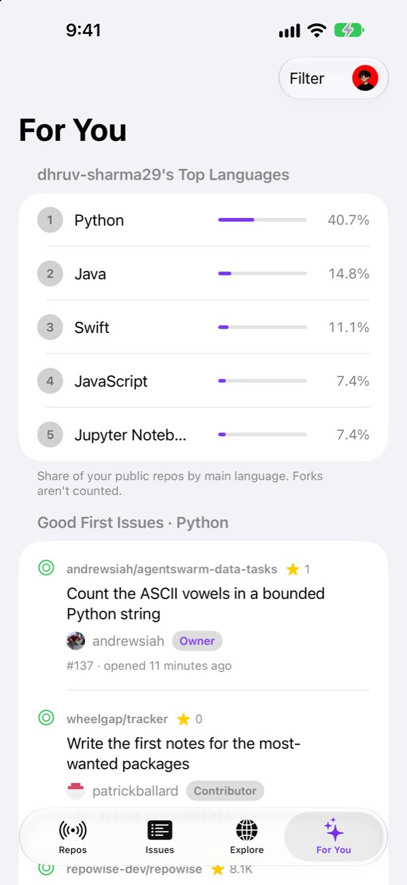
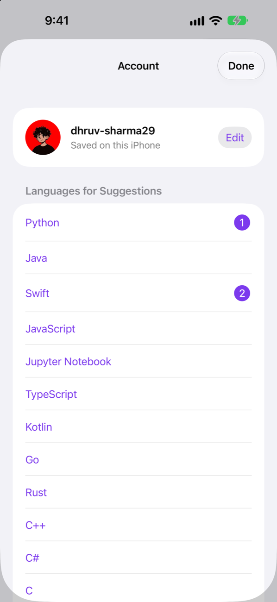
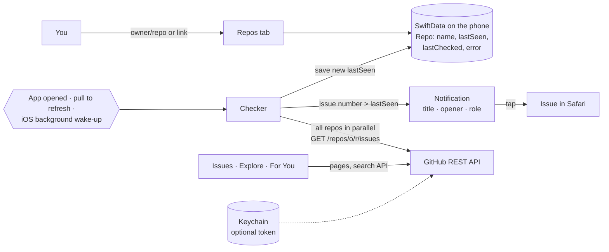

<p align="center">
  
</p>

# Ping

An iPhone app that watches the GitHub repositories you choose and **notifies you when someone opens
a new issue**, saying who opened it and how they relate to the repo (owner, member, contributor,
first-timer). It also lists every issue across your repos, shows the newest issues on all of
GitHub by language, and suggests beginner-friendly issues in the languages you write.

No server and no GitHub login needed: the app talks to GitHub's public REST API directly and keeps
everything on the phone. Built with SwiftUI, SwiftData, BackgroundTasks and UserNotifications, with
no third-party packages.

> **Status (2026-11-11):** runs on an iPhone 15 and in the iOS Simulator. New-issue notifications
> arrive on the phone (and on a paired Mac). Background checks are wired up and iOS accepts the
> requests, but **iOS decides when they run**: a phone-only app can't promise alerts within minutes.
> Personal build, signed with a free Apple ID; not on the App Store.

## Screenshots

| Watched repos | Issues in a repo | Notification |
| :---: | :---: | :---: |
|  |  |  |
| Star counts, last check, errors | Who opened it, and their role | Repo, opener, role, issue title |

| All issues | Explore | For You | Account |
| :---: | :---: | :---: | :---: |
|  |  |  |  |
| Search and filter | Newest issues on GitHub, by language | Your languages, good first issues | Username, languages, token |

Screenshots: iPhone 18 Pro Max simulator, iOS 27, live GitHub data on 2026-11-11.

## How it works



1. **Adding a repo** records its newest issue number (`lastSeen`) and sends nothing, so you aren't
   flooded with old issues.
2. **Every check** fetches the newest 100 issues and pull requests, drops the pull requests, and
   notifies you once for each issue numbered above `lastSeen`. Issue numbers only go up, so this
   needs no clocks or timestamps.
3. **Checks run** when you open the app (at most every 5 minutes), when you pull to refresh, and
   when iOS gives Ping background time.
4. **Issues** lists every issue from your repos, notified or not, and loads older pages as you
   scroll back to each repo's first issue. **Explore** shows the newest open issues on all of
   GitHub by language and keyword. **For You** ranks your languages from your public repos and
   suggests unassigned good first issues in them.

Design record: [docs/01-architecture.md](docs/01-architecture.md) ·
[docs/02-checking-and-notifications.md](docs/02-checking-and-notifications.md)

## What has been verified

| Behaviour | Result | Evidence |
| --- | --- | --- |
| Adding a repo sends no notifications for issues that already existed | Pass | Unit test `firstCheckOnlySeeds`; Simulator: `lastSeen` seeded, no banner |
| Each issue newer than the last one seen notifies exactly once | Pass | Unit test `onlyIssuesAfterLastSeen`; Simulator: `lastSeen` lowered by 2 → 2 notifications |
| Pull requests never notify | Pass | Unit test `decodeDropsPullRequests` |
| Notification shows the opener and their GitHub role | Pass | Unit tests `decodeReadsAuthorAndRole`, `roleLabels`; seen on the iPhone 15 (`huggingface/transformers` #50472, Contributor) |
| Issues tab search and filters (state, repo, who opened it) | Pass | Unit tests `searchMatchesTitleAuthorRepoAndNumber`, `filtersCombine` |
| Older issues load in order, never inserted above what you've read | Pass | Unit test `feedOnlyEverAppendsOlderIssues` |
| Stays under GitHub's rate limit | Pass | Unit tests `rateLimitBlocksUntilReset`, `starCacheRefetchesAfterADay`, `checksAtMostEveryFiveMinutesUnlessAsked`; Simulator: a check of 2 repos used 2 requests, reopening 13 s later used 0 |
| A token that GitHub rejects is not saved | Pass | Simulator: made-up token refused with *"GitHub didn't accept this token"*; not found in any app file |
| Background check on the phone | **Not confirmed** | iOS accepted both wake-up requests on the iPhone 15; a background run hasn't been observed yet. See Account → Background Checks |

**30 unit tests**, all passing (Swift Testing). How each row was checked, and what it does not
prove: [docs/03-verification.md](docs/03-verification.md).

## Staying under GitHub's rate limit

Without a login GitHub allows **60 requests an hour per internet address**, shared with everyone on
the same network. Early builds used that up in about a minute. Now:

| Measure | Effect |
| --- | --- |
| Optional GitHub token (Account → GitHub Token) | 5,000 requests an hour, for you alone |
| Wait for GitHub's reset time after a limit response | No requests that are certain to fail; rows say *"Resets at 8:42"* |
| Star counts cached on the phone for a day | One request per repo per day instead of per launch |
| Automatic checks at most every 5 minutes | Reopening the app repeatedly costs nothing |
| All repos fetched in parallel | A check of 10 repos takes ~1–2 s, inside iOS's ~30 s background window |

The token should be a **fine-grained token with no permissions** (public data only). Ping checks it
with GitHub before saving, keeps it only in the iOS Keychain on this device, and sends it only in
the `Authorization` header to `api.github.com`.

## Run it

Requirements: macOS with Xcode 27.1 and [XcodeGen](https://github.com/yonaskolb/XcodeGen). The
deployment target is iOS 18.0.

```bash
brew install xcodegen
xcodegen                    # generates Ping.xcodeproj from project.yml
open Ping.xcodeproj         # Run (⌘R) on a simulator, ⌘U for the tests
```

Installing on your own iPhone (change the bundle ID and team in `project.yml` first), testing
background checks, and the 7-day limit of free signing: [RUNBOOK.md](RUNBOOK.md).

## Privacy

- **Only GitHub is contacted:** the REST API and avatar images. No analytics, no third-party SDKs,
  no server of our own.
- **Your username is public data** and is stored on the phone only. An optional token stays in the
  Keychain.
- **Input is validated** before it goes into a URL: repo names must match `owner/repo`,
  usernames GitHub's own rules.

## Repository layout

```text
Ping/
  App/        app entry, tabs, background-task wiring
  Repos/      watched repos, add field, repo row, notifications/background warning cards
  Issues/     issue model, per-repo list, Issues tab, search and filter logic, author line
  Explore/    newest issues on GitHub by language
  ForYou/     For You tab, Account sheet, token field, suggestion filters
  Checking/   GitHub client, Checker, rate-limit pause, token store, background log
  Stars/      star counts and their day-long cache
PingTests/    unit tests (Swift Testing)
Design/       logo originals and make-icons.py
docs/         design record and README images
project.yml   source of truth for the Xcode project (Ping.xcodeproj is generated)
```

## Limitations

- **Timing is up to iOS.** Background checks run when iOS allows, often every 30 minutes to a few
  hours, and never after you swipe Ping away in the app switcher until you open it again.
- **Up to 100 new issues and pull requests per check.** More than that between two checks and the
  oldest are never notified.
- **Public repositories only.**
- **Free signing expires after 7 days**; reinstall from Xcode.
- **The logo includes GitHub's Octocat**, a GitHub trademark: fine for a personal build, must be
  replaced before any App Store release.

Reliable, minute-level alerts need something running outside the phone; a Telegram bot on a
scheduled job is the planned next step ([docs/04-roadmap.md](docs/04-roadmap.md)).

## Docs

Start with [RUNBOOK.md](RUNBOOK.md) to build and install it. The design record is in
[docs/](docs/README.md):

| # | Doc | What it settles |
| --- | --- | --- |
| 00 | [Charter](docs/00-charter.md) | Problem, scope, success criteria |
| 01 | [Architecture](docs/01-architecture.md) | Components, data model, decisions |
| 02 | [Checking and notifications](docs/02-checking-and-notifications.md) | How "new" is decided, when checks run, guarantees |
| 03 | [Verification](docs/03-verification.md) | Unit tests, Simulator and device runs, gaps |
| 04 | [Roadmap](docs/04-roadmap.md) | Milestones, Telegram bot, backend option |
| 05 | [Risks](docs/05-risks.md) | Rate limits, background timing, claim hygiene |
| 06 | [Implementation notes](docs/06-implementation-notes.md) | Where the code departs from the plan, bugs found |

Planning: [PLAN.md](PLAN.md). No license has been chosen yet, so all rights are reserved by default.
