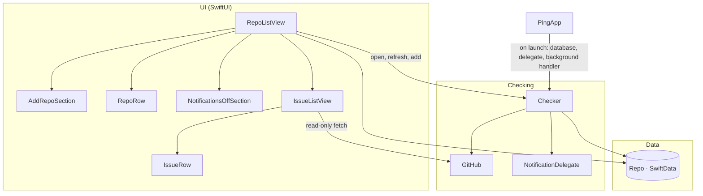

# 01 — Architecture

## Layers

Everything runs on the main actor (the project sets main-actor default isolation). Network calls
are `async`, so the main thread is never blocked; the only work off the main actor is the two
notification delegate callbacks, which iOS calls on its own queue.

## Data model

One SwiftData model, stored in the app's default store (`Repos/Repo.swift`):

| Field | Type | Meaning |
| --- | --- | --- |
| `name` | `String`, unique | `owner/repo`, already normalised |
| `lastSeen` | `Int?` | Highest issue number already handled. `nil` until the first successful check |
| `lastChecked` | `Date?` | Time of the last successful check, shown on the row |
| `error` | `String?` | Message from the last failed check; cleared on success |

`owner`, `shortName` and `avatarURL` are computed from `name`. Issues are **not** stored: the issue
list is fetched each time it's opened. `lastChecked` was added after the first build; SwiftData
migrated the existing store automatically ([03](03-verification.md) § M3).

## The check path

`Checker.run()` (`Checking/Checker.swift`):

1. Return at once if a check is already running. Without this, opening the app while a background
   check is in progress could notify twice for the same issue.
2. Load every `Repo`.
3. For each repo: `GitHub.issues(for:)` fetches the newest 100 items, `state=all`, sorted by
   creation, and drops pull requests. Then `GitHub.newIssues(_:lastSeen:)` picks issues numbered
   above `lastSeen` (none on the first check), one notification is posted per new issue,
   `lastSeen` becomes the highest number seen, `lastChecked` becomes now, and `error` is cleared.
4. On an error, store its message on that repo and continue with the next one. If the error is
   because iOS ended the background time (task cancelled), stop and keep what's done.
5. Save.

Rules for when this runs, and what each guarantees: [02](02-checking-and-notifications.md).

## Components

| Component | File | Owns | Talks to |
| --- | --- | --- | --- |
| App entry | `App/PingApp.swift` | The `ModelContainer`, notification delegate, scheduling on background, the `.appRefresh` handler | Checker |
| Checker | `Checking/Checker.swift` | One check of all repos, notifications, the next background request | GitHub, SwiftData, UserNotifications, BackgroundTasks |
| GitHub client | `Checking/GitHub.swift` | Input normalisation, the API request, status-code mapping, decoding, the "new issue" rule | `api.github.com` |
| Errors | `Checking/GitHubError.swift` | User-readable error messages | — |
| Notification delegate | `Checking/NotificationDelegate.swift` | Banners while the app is open; tap → open the issue URL | UIKit (`UIApplication.open`) |
| Repo list | `Repos/RepoListView.swift` | The main screen, permission request, checks on open and on return to the app | Checker, SwiftData |
| Add repo | `Repos/AddRepoSection.swift` | Text field, + button, inline validation error | GitHub.normalize |
| Repo row | `Repos/RepoRow.swift` | Avatar, name, owner, last-checked or error line | — |
| Notifications-off card | `Repos/NotificationsOffSection.swift` | Explains denied permission, opens the app's notification settings | Settings app |
| Issue list / row | `Issues/IssueListView.swift`, `Issues/IssueRow.swift` | Fetch-and-show the newest issues; loading, empty and error states | GitHub |
| All-issues tab | `Issues/AllIssuesView.swift`, `Issues/IssueFilterMenu.swift`, `Issues/IssueFilter.swift`, `Issues/RepoIssue.swift`, `App/RootView.swift` | Fetches every repo in parallel, merges newest first, search + filter menu; `IssueFilter.matches` is pure and unit tested | GitHub |
| Issue author | `Issues/IssueAuthor.swift`, `Issues/AuthorRole.swift`, `Issues/AuthorLine.swift` | Opener's login and avatar (`user`), their role (`author_association`) with labels, and the avatar · name · badge line | GitHub avatars |

## Decisions

| Decision | Alternative | Why |
| --- | --- | --- |
| App only (Option A) | App + backend + Apple push (Option B) | Free and private, and every piece is reused if B is built later. Cost: no timing guarantee ([PLAN.md](../PLAN.md)) |
| Highest issue number as state | Timestamps; a set of seen IDs | Issue numbers are assigned in increasing order per repo **[verify]** against GitHub docs (observed on `swiftlang/swift`), so one integer per repo is enough and there's no clock skew |
| First check seeds, never notifies | Notify about recent issues on add | Adding a busy repo would otherwise fire dozens of notifications |
| `state=all` | `state=open` | An issue opened and closed between checks is still new |
| 100 items per request | 30 (GitHub default) | In PR-heavy repos most of the newest 30 items are PRs, which leaves few issues and a high risk of missing some ([06](06-implementation-notes.md) § 9) |
| Show GitHub's `author_association` as-is | Look up org membership or commit history | Already in every issue in the same response: no extra requests, no token. Owner, Member and Collaborator are highlighted in the accent colour; an unknown future value shows as *No association* rather than failing |
| Issues tab fetches live on open and pull-to-refresh | Store issues in SwiftData | Always current, no cache to invalidate. Cost: one request per repo each time (see [05](05-risks.md) § R3) |
| Filter by opener *group* (maintainers, contributors, newcomers, no association) | One filter per GitHub role | Eight roles is too many to scan; the groups answer the real question, "is this from a maintainer or a newcomer?" |
| Unauthenticated requests | Personal access token in the Keychain | No secret on the phone. Planned token support isn't built ([06](06-implementation-notes.md) § 1) |
| One check at a time (`running` flag) | Allow overlapping checks | Two overlapping checks read the same `lastSeen` and would notify twice |
| Local notifications, identifier `owner/repo#number` | Random identifiers | A repeated notification for the same issue replaces the earlier one instead of stacking |
| Show banners while the app is open | iOS default (no banner in foreground) | Most checks happen on open; without this the user would never see them |
| SwiftData | Core Data, JSON file, `UserDefaults` | Native, migrates added fields automatically, works with `@Query` for live UI updates |
| XcodeGen (`project.yml`) | A hand-maintained `.xcodeproj` | Readable, diffable project definition; the generated project is disposable |
| Feature folders, one type per file | Flat folder | Follows the SwiftUI review guidance used during the redesign |
| No third-party packages | Networking/UI libraries | Apple's SDK covers everything; nothing to audit or update |
